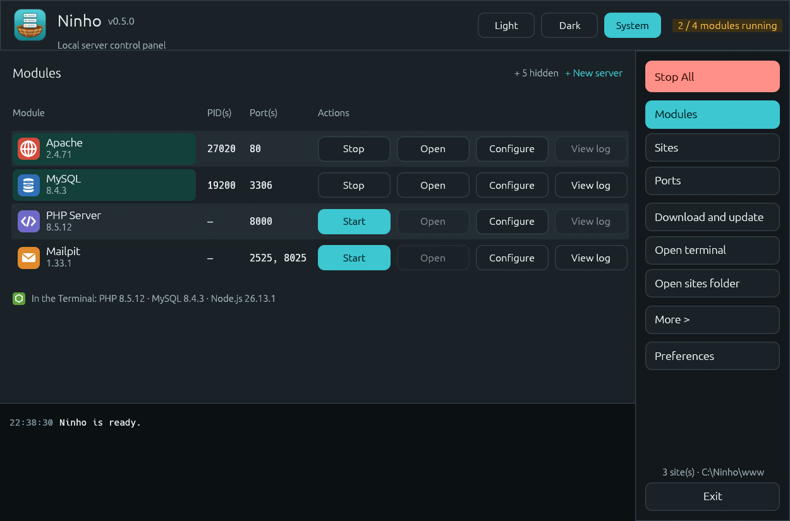
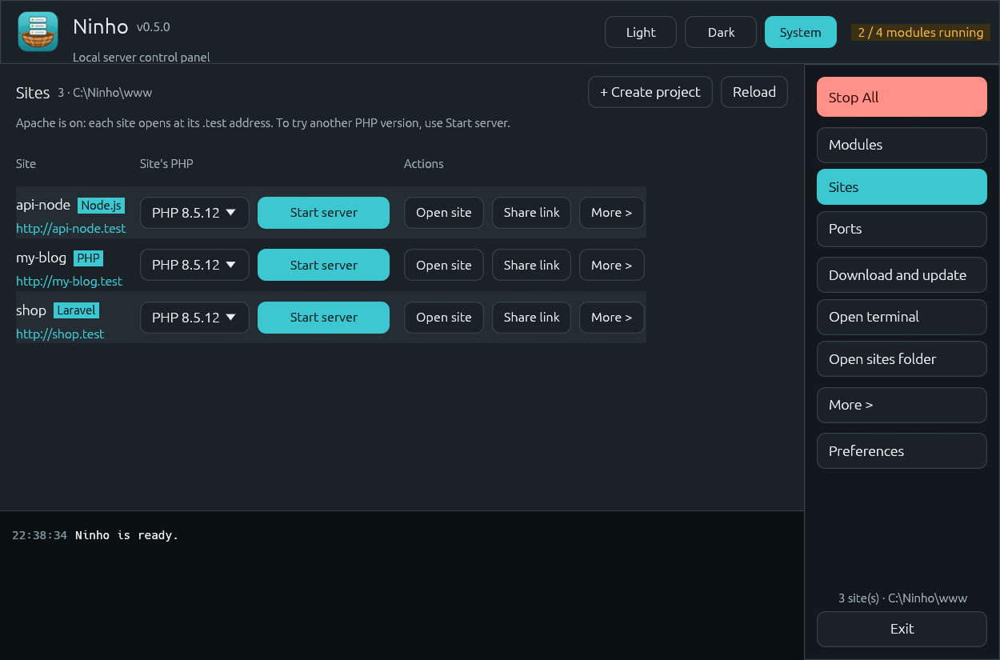
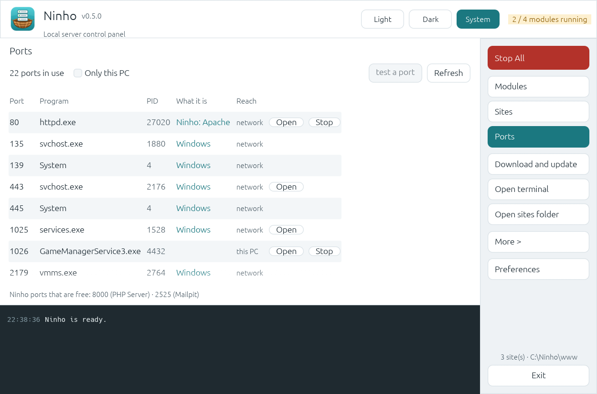
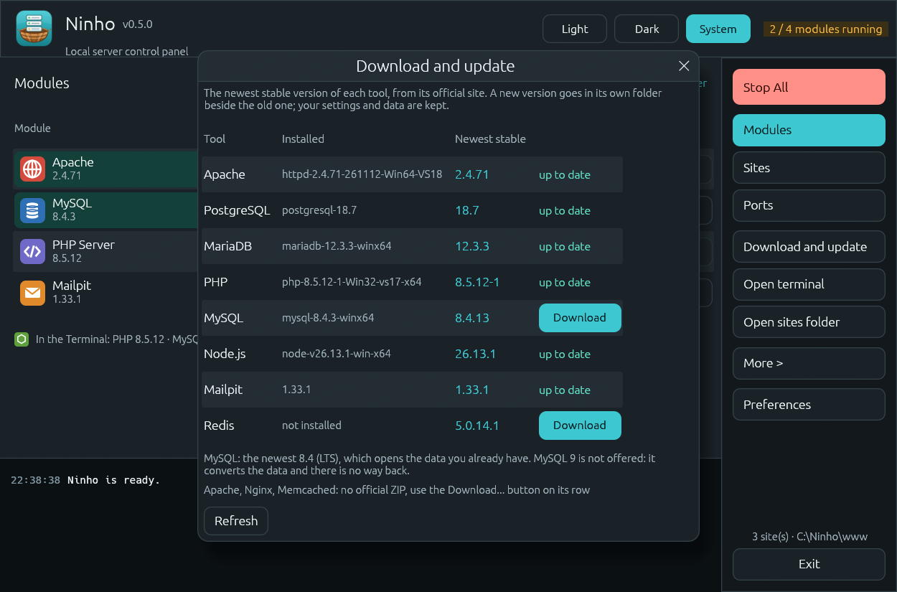

<div align="center">


# Ninho — free, portable local server for Windows

**A modern alternative to XAMPP, WampServer and Laragon.**
Start Apache, MySQL, MariaDB, PostgreSQL, PHP, Node.js, Mailpit and Redis from one small control panel.
Download the newest stable Apache, PHP, MySQL, Node.js, Mailpit and Redis with one click. No installer: just open `Ninho.exe`.

[Download](https://github.com/phmrmkv/Ninho/releases/latest) ·
[Website](https://phmrmkv.github.io/Ninho/) ·
[Features](#features) ·
[Quick start](#quick-start) ·
[Roadmap](ROADMAP.md) ·
[Português](#português)

</div>



## Why Ninho

If you develop PHP, WordPress, Laravel or Node.js on Windows you need a local web server, a database and a mail catcher.
XAMPP and WampServer are classic but heavy and slow to update; Laragon is great but closed. Ninho is a **free, open
source (MIT or GPL-3.0, your choice), portable** local development environment written in Rust:

- **One file, no installer.** `Ninho.exe` (~19 MB) keeps its settings in `ninho.json` beside it. Copy the folder to a
  USB stick or another PC and it works.
- **Always the newest stable versions.** The *Download and update* window reads the official sites (windows.php.net,
  dev.mysql.com, nodejs.org, GitHub) and installs PHP, MySQL, Node.js, Mailpit and Redis side by side with the
  versions you already have. Your settings and data are kept.
- **See every port.** A *Ports* tab lists every program listening on your PC (like `netstat`), tells you who holds
  port 80 or 3306, and can stop it. If Windows itself holds a port (it happens with 1025, Mailpit's default), Ninho
  explains it and moves the server to a free port in one click.
- **More than one of each.** Run two MySQL servers (each with its own data folder), several PHP servers or Redis
  instances on different ports at the same time.
- **Classic control panel.** A module table with PID, port, *Start / Stop*, *Admin*, *Config* and *Logs*, like the
  XAMPP Control Panel, plus WampServer-style menus to switch versions and turn PHP extensions on and off.

## Features

| | |
|---|---|
| **Modules** | Apache, MySQL (8.4 LTS), MariaDB (LTS), PostgreSQL, MongoDB, PHP built-in server, Mailpit, Redis, Memcached, Nginx, Caddy |
| **Tools on the PATH** | PHP, MySQL client, Node.js / npm / npx, Composer and Git when present (Terminal button) |
| **Version manager** | Newest stable PHP, MySQL 8.4, Node.js LTS, Mailpit and Redis from their official sites; pick the version per module |
| **PHP extensions** | Turn `mysqli`, `pdo_mysql`, `gd`, `intl`, `curl`, `zip`... on or off from the Config menu (edits `php.ini` for you) |
| **Database admin** | *Admin* on MySQL opens HeidiSQL when installed, otherwise [Adminer](https://www.adminer.org) served by your PHP |
| **Apache in one click** | Newest Win64 build, set up for your PHP (as a module), your `www` folder and the `.test` sites |
| **Virtual hosts** | Every folder in `www` becomes `http://<folder>.test` (hosts file and Apache/Nginx configs written for you; Caddy gets a Caddyfile and serves them on port 2015) |
| **Docker in Ports** | When Docker is running, its containers show in the Ports tab as `Docker: name (image)` with a *Stop container* button; without Docker nothing changes |
| **HTTPS** | One switch gives every `.test` site a certificate from Ninho's local authority (trusted for your user only) |
| **Sites tab** | Each site with its kind (Laravel, WordPress, Symfony, Node.js...), its address, Open, Terminal, VS Code |
| **PHP per site** | Run one site on its own PHP server with its own PHP version, side by side with Apache |
| **Share a site** | A public `https://….trycloudflare.com` link in one click (Cloudflare quick tunnel, no account) |
| **Databases** | Back up, restore and import `.sql` files for every MySQL server |
| **Xdebug** | Downloads the build that matches your PHP and turns it on or off |
| **Quick projects** | Blank, WordPress, Laravel or Symfony, with its database created at the same time |
| **Ports** | Every listening port with program, PID and reach (this PC or the network); test a port; stop a program safely (Windows' own processes are protected) |
| **Mail catcher** | Mailpit catches every e-mail your app sends; open the inbox from *Admin* |
| **Tray icon** | Status dot (green / orange / grey) and a menu next to the clock; closing the window keeps Ninho running |
| **Themes** | Light, dark, or follow Windows |
| **Logs** | Live log viewer with filter, for every module |
| **Command line** | `Ninho.exe status --json`, `start`, `stop`, `reload`, `--install php mysql nodejs` |
| **Portable or installed** | Run it from any folder, or click *Install on this PC* (Start menu + Windows Installed apps, no administrator rights) |
| **Import** | Bring your sites and databases from XAMPP, WampServer or Laragon. Sites are copied into `www`, databases into Ninho's MySQL; the old install is only read |
| **Updates** | Ninho checks GitHub releases when it opens (can be turned off), downloads the right exe, checks its SHA-256 and restarts. Also in the menu: *Check for a new Ninho* |
| **First start** | A welcome window: language, Ninho folder and what to download now (Apache, PHP and MySQL are checked by default) |
| **One window** | Opening Ninho again brings the open window forward, also from the tray |
| **Crash log** | If Ninho breaks, the reason goes to `tmp\ninho-crash.log` and a message tells you where it is |
| **Languages** | 18: English, Português, Español, Français, Deutsch, Italiano, Nederlands, Polski, Русский, Українська, Türkçe, Bahasa Indonesia, Tiếng Việt, 日本語, 한국어, 简体中文, 繁體中文, हिन्दी |







## Quick start

1. Download **`Ninho-x64.exe`** (Windows 10/11 64-bit) or **`Ninho-x86.exe`** (32-bit Windows) from the [latest release](https://github.com/phmrmkv/Ninho/releases/latest).
2. Put it in an empty folder (for example `C:\ninho`) or in an existing `C:\laragon` folder: Ninho uses the `bin`,
   `data` and `www` folders it finds beside it.
3. Open it, click **Download and update** and download PHP, MySQL and anything else you need.
4. Click **Start All**. Your sites live in `www`; `www\blog` answers at `http://blog.test`.

Prefer a package manager? These work after the first release is published:

```powershell
winget install Phmrmkv.Ninho
scoop bucket add ninho https://github.com/phmrmkv/scoop-ninho
scoop install ninho
```

Coming from XAMPP or WampServer? On the first start, or later in the menu, Ninho offers to import your sites and databases. The old install is only read.

Coming from Laragon? Put `Ninho.exe` in `C:\laragon`: your `bin`, `data\mysql-8.4` and `www` are used as they are.

## Use Ninho from AI agents (MCP)

Ninho ships a Model Context Protocol server, so coding agents such as Claude Code or Cursor can see and control your
local servers. It runs over stdio: the agent launches `Ninho.exe mcp` itself, and you don't need to open the window.

Claude Code:

```bash
claude mcp add ninho -- "C:\laragon\Ninho.exe" mcp
```

Cursor and other clients (`mcp.json`):

```json
{ "mcpServers": { "ninho": { "command": "C:\\laragon\\Ninho.exe", "args": ["mcp"] } } }
```

Tools: `status`, `start`, `stop`, `restart`, `list_sites` and `read_log`. Try: "Which servers are running?", "Restart
Apache and show me the last 50 lines of its log".

## Build from source

```bash
git clone https://github.com/phmrmkv/Ninho.git
cd Ninho
cargo build --release
```

Needs Rust (stable). The window and exe icons come from `assets/ninho.svg`; after changing it run
`node build-icons.cjs assets` (needs the `sharp` package).

## FAQ

**Is Ninho free?** Yes, free and open source, under the MIT or the GPL-3.0 license, at your choice.

**Does it replace XAMPP / WampServer / Laragon?** For PHP + MySQL + Node.js development on Windows, yes. It can also
run next to them: the Ports tab shows who is using each port.

**Which MySQL version?** The newest 8.4 LTS. MySQL 9 is not offered on purpose: it converts the data folder and there
is no way back.

**Can I move my XAMPP, WampServer or Laragon projects?** Yes. Ninho finds the install, copies the sites into `www` and copies the databases into its own MySQL. The old install is only read, so you can keep it. A site folder that already exists in `www` is never overwritten.

**Does Ninho update itself?** Yes. When it opens, it checks the GitHub releases; if there is a newer one, it asks, downloads the right exe for your Windows, checks its SHA-256 and restarts. You can turn the check off in Preferences. Your settings, data and sites are not touched.

**What if Ninho crashes?** The reason is written to `tmp\ninho-crash.log` beside Ninho, and a message shows where. Attach it to a bug report.

**Where are my settings?** In `ninho.json`, beside `Ninho.exe`.

**32-bit Windows?** Use `Ninho-x86.exe`. PHP, Apache, Mailpit, Node.js (up to 22) and cloudflared have 32-bit builds; MySQL 8.4, MariaDB, PostgreSQL, MongoDB, Caddy and Redis don't, and Ninho tells you so.

**Linux or macOS?** Not yet: see the [roadmap](ROADMAP.md). Ninho's window already runs there; the server management is Windows-only for now.

**Can I translate Ninho?** Yes: copy `locales/en.json` to `locales/<your-language>.json`, translate the values and open a pull request.

## Roadmap

MongoDB, Caddy, per-project config files, Linux and macOS and more: see
[FEATURES.md](FEATURES.md) (everything the other local servers offer, checked as it lands) and [ROADMAP.md](ROADMAP.md).

---

## Português

**Ninho é um servidor local gratuito e portátil para Windows**, alternativa ao XAMPP, ao WampServer e ao Laragon.
Liga Apache, MySQL, PHP, Node.js, Mailpit e Redis num painel só e baixa a última versão estável de cada um com um
clique, direto dos sites oficiais. Não tem instalador: é só abrir o `Ninho.exe`.

- **Portátil:** um `.exe` só; as configurações ficam no `ninho.json` ao lado dele.
- **Sempre atualizado:** a janela *Baixar e atualizar* busca PHP, MySQL 8.4 (LTS), Node.js (LTS), Mailpit e Redis nos
  sites oficiais e instala ao lado das versões que você já tem, mantendo configurações e dados.
- **Todas as portas:** a aba *Portas* mostra cada programa escutando no PC, com PID e alcance; quando o próprio
  Windows ocupa uma porta (acontece com a 1025 do Mailpit), o Ninho explica e troca para uma livre com um clique.
- **Mais de um de cada:** dois MySQL (cada um com sua pasta de dados), vários servidores PHP ou Redis em portas
  diferentes, ao mesmo tempo.
- **Painel clássico:** tabela de módulos com PID, porta, *Ligar/Desligar*, *Admin*, *Config* e *Logs*, como o painel
  do XAMPP, e menus no estilo do WampServer para trocar versão e ligar extensões do PHP.

- **Importa do XAMPP, WampServer e Laragon:** copia seus sites para `www` e seus bancos de dados para o MySQL do Ninho. A instalação antiga só é lida, nunca alterada.
- **Atualiza sozinho:** ao abrir, o Ninho vê se há versão nova no GitHub, baixa o `.exe` certo, confere o SHA-256 e reinicia. Dá para desligar nas Preferências.
- **Primeira vez guiada:** uma janela de boas-vindas pergunta o idioma, a pasta do Ninho e o que baixar agora (Apache, PHP e MySQL já vêm marcados).
- **Uma janela só:** abrir o Ninho de novo traz a janela que já está aberta, até da bandeja.
- **Registro de falhas:** se o Ninho quebrar, o motivo vai para `tmp\ninho-crash.log` e uma mensagem mostra onde está.
- **18 idiomas**, seguindo o idioma do Windows na primeira vez.

Instalar por gerenciador de pacotes (funciona depois da primeira release):

```powershell
winget install Phmrmkv.Ninho
scoop bucket add ninho https://github.com/phmrmkv/scoop-ninho
scoop install ninho
```

Vindo do XAMPP ou do WampServer? Na primeira vez, ou depois pelo menu, o Ninho oferece importar seus sites e bancos. A instalação antiga só é lida.

Vindo do Laragon? Coloque o `Ninho.exe` em `C:\laragon`: as pastas `bin`, `data\mysql-8.4` e `www` são usadas como
estão.

## Code signing policy

Free code signing provided by [SignPath.io](https://about.signpath.io), certificate by [SignPath Foundation](https://signpath.org).

- Committers and reviewers: [phmrmkv](https://github.com/phmrmkv)
- Approvers: [phmrmkv](https://github.com/phmrmkv)

Every release is built from this repository by [GitHub Actions](.github/workflows/release.yml), and every signing request is approved by hand.

## Privacy

This program will not transfer any information to other networked systems unless specifically requested by the user or the person installing or operating it.

What Ninho reaches on the internet, and only for what you use:
- **Updates of Ninho:** when it opens, it asks GitHub for the latest release of Ninho (switch it off in Preferences).
- **Downloads:** *Download and update* reads the official sites of each program (windows.php.net, dev.mysql.com, nodejs.org, Apache Lounge, mariadb.org, postgresql.org, downloads.mongodb.org, xdebug.org, adminer.org, GitHub) to list and download versions.
- **Share a site:** *Share link* starts a Cloudflare quick tunnel ([Cloudflare's privacy policy](https://www.cloudflare.com/privacypolicy/)); your site is reachable through that link until you stop sharing.

Ninho sends no usage data, no crash reports and no identifiers. A crash is written only to `tmp\ninho-crash.log` on your PC.

## License

Dual-licensed under [MIT](LICENSE-MIT) or [GPL-3.0](LICENSE-GPL-3.0), at your option. © phmrmkv. Ninho is not affiliated with Apache, Oracle (MySQL), the PHP Group, the OpenJS
Foundation (Node.js), Mailpit, Redis, XAMPP, WampServer or Laragon; their names are used only to say what Ninho runs
or replaces.
